# TalentOS

TalentOS is an AI-powered recruitment platform designed to simplify hiring from candidate onboarding to assessment and screening. Built with Angular and FastAPI, it brings together authentication, workflow orchestration, anti-spoofing checks, and resume intelligence in one local-first system.

[Demo](https://github.com/user-attachments/assets/174e5fb7-b7f5-4249-80d1-78ade8f9e9c9)

## Why TalentOS?

- Streamline candidate onboarding and recruiter workflows
- Support OTP login and face-based identity verification
- Run scheduling, assessments, notifications, and AI-assisted coordination in one stack
- Add liveness checks for video and audio anti-spoofing
- Parse resumes and score them with ATS-style analysis

## What is in this repo?

- `frontend/`: Angular app for project managers and candidates
- `backend/authentication/`: OTP login and candidate face registration/verification
- `backend/orchestration/`: jobs, scheduling, assessments, notifications, AI workflows, and realtime coordination
- `backend/anti_spoofing/`: video and audio liveness / anti-spoofing checks
- `backend/ats_parser_checker/`: resume parsing, ATS scoring, retrieval, and ranking
- `backend/models/`: shared local model cache used by the backend services. See `backend/models/README.md` for the model list and download sources
- `run-all.ps1` and `run-all.sh`: helper scripts to start the full stack locally

## Screenshots

<div align="center">
  <div style="display:flex; overflow-x:auto; gap:16px; padding:8px 0; scroll-snap-type:x mandatory;">
    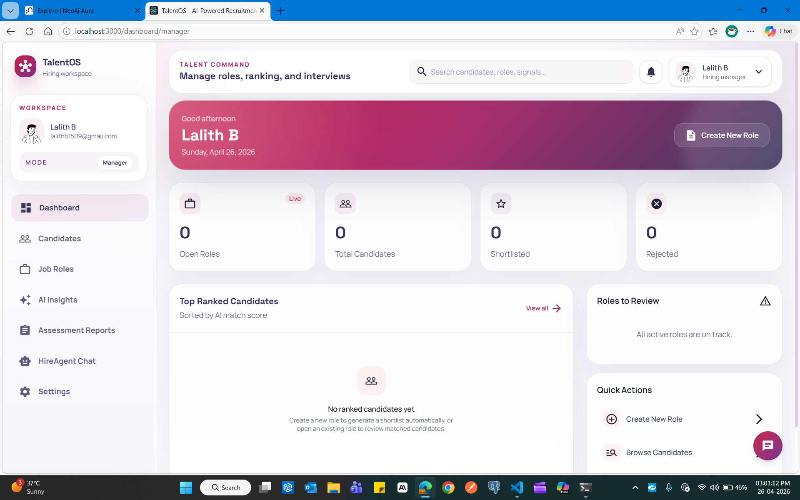
    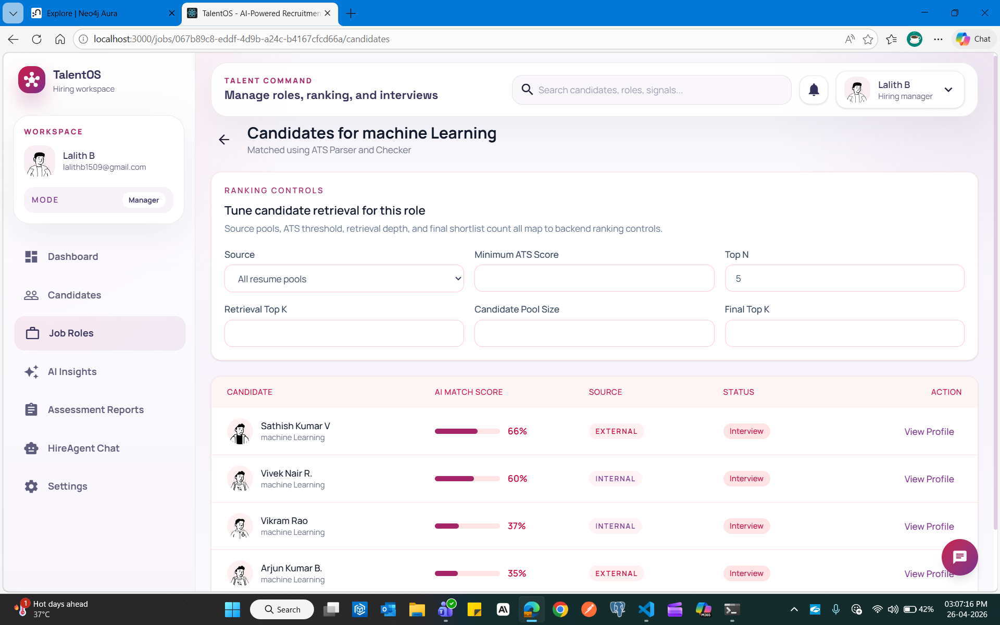
    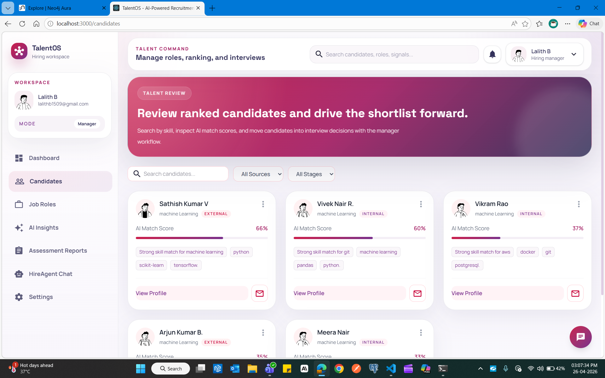
    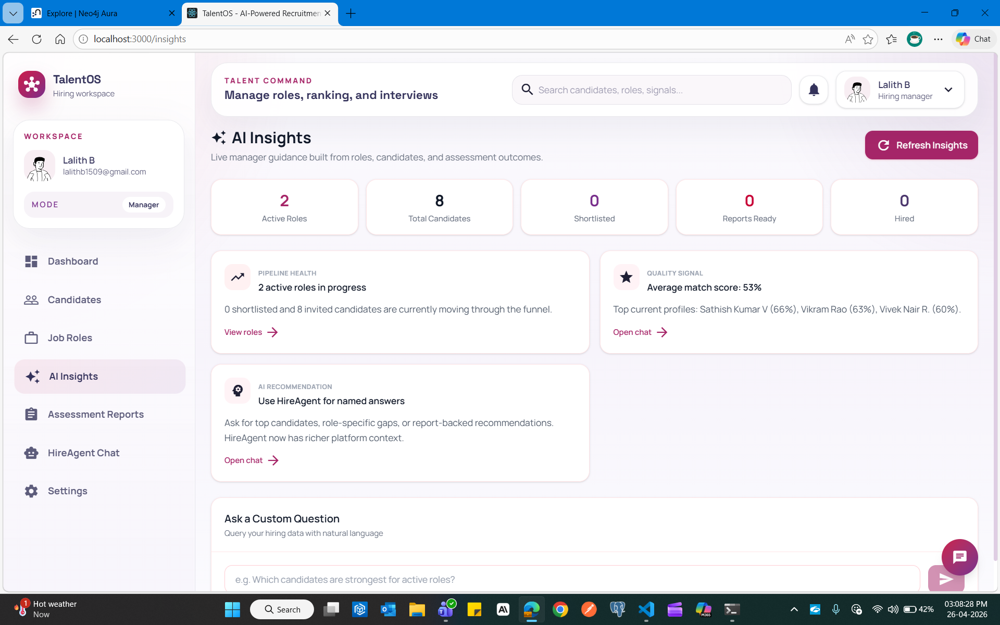
    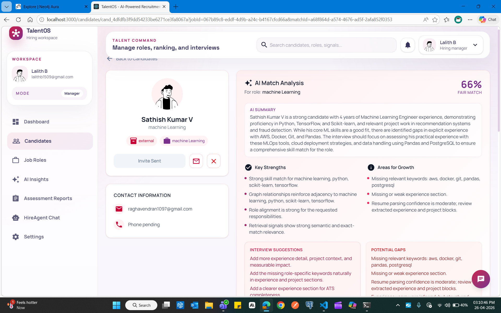
    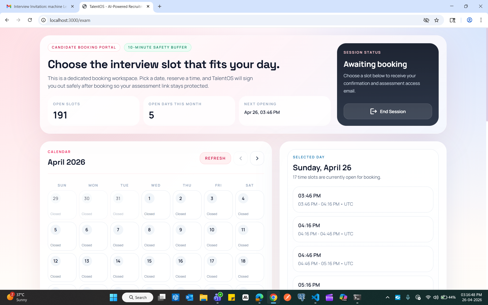
    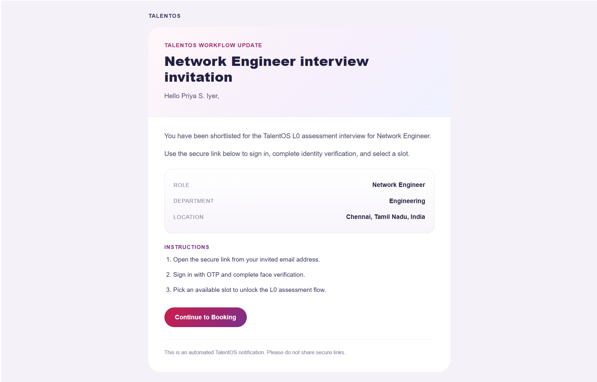
    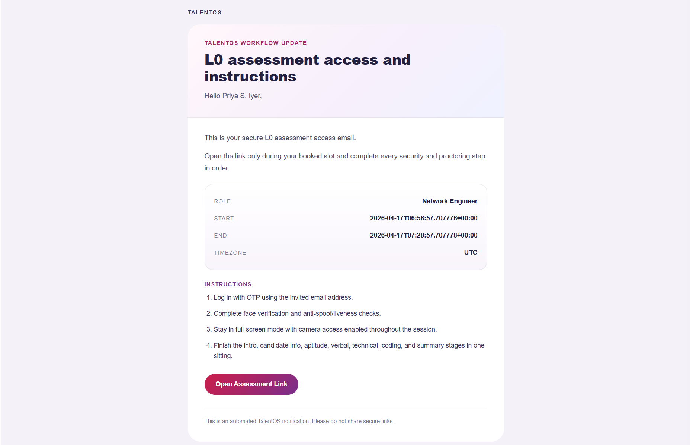
    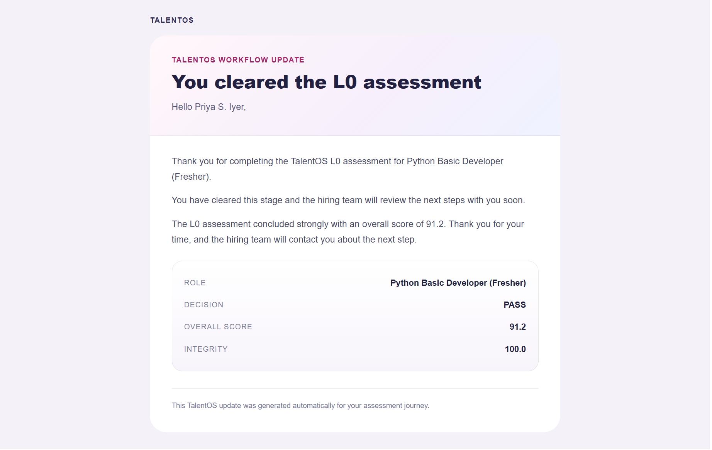
    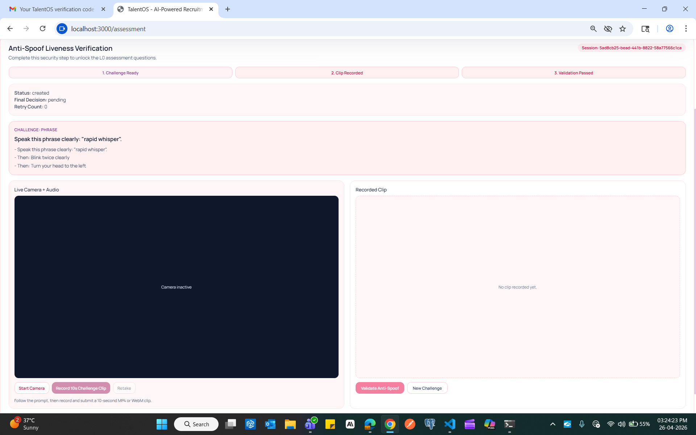
    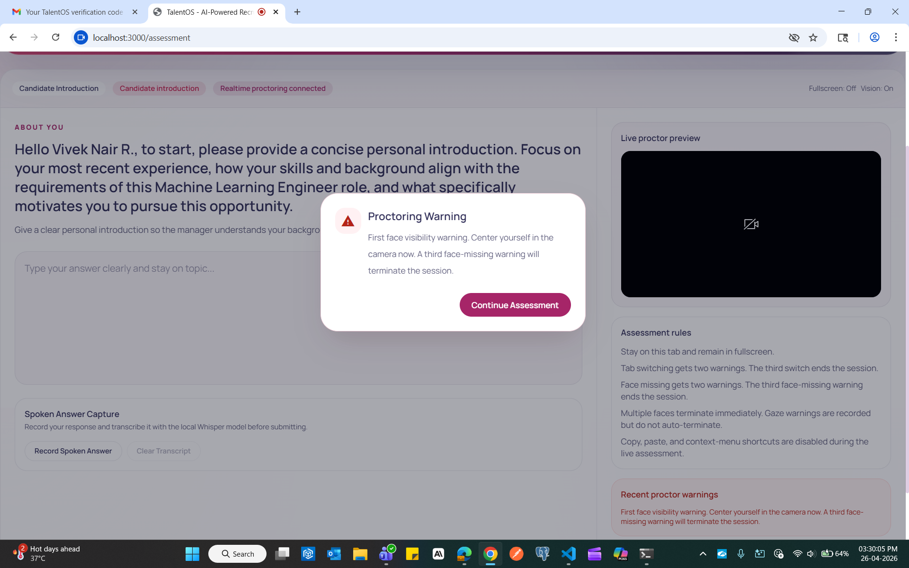
    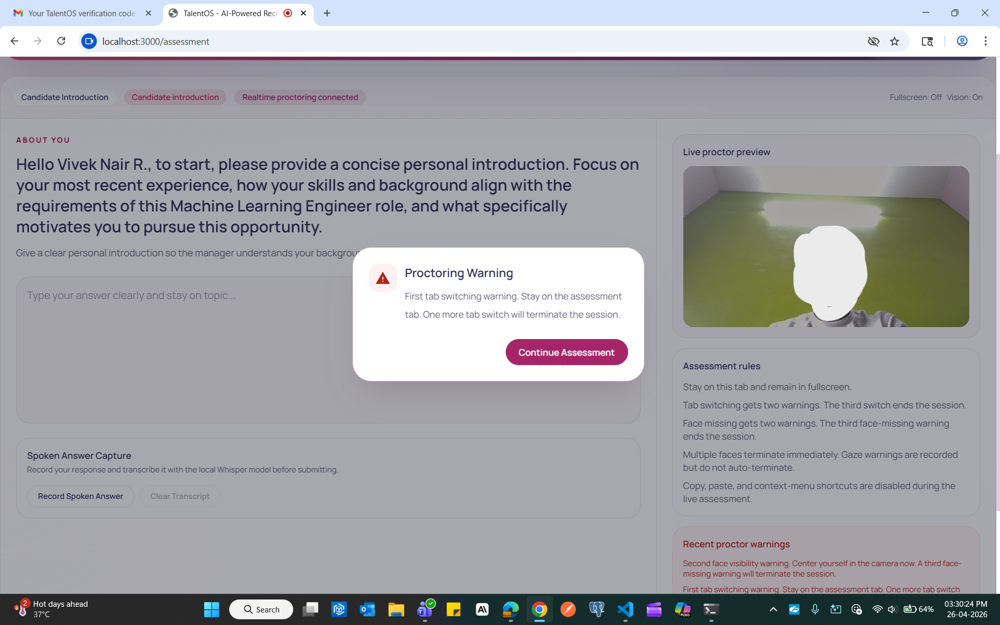
    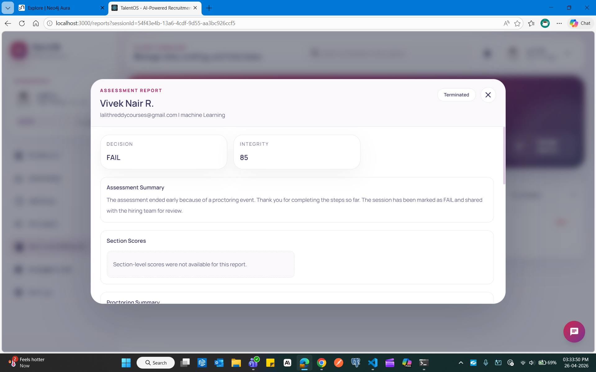
    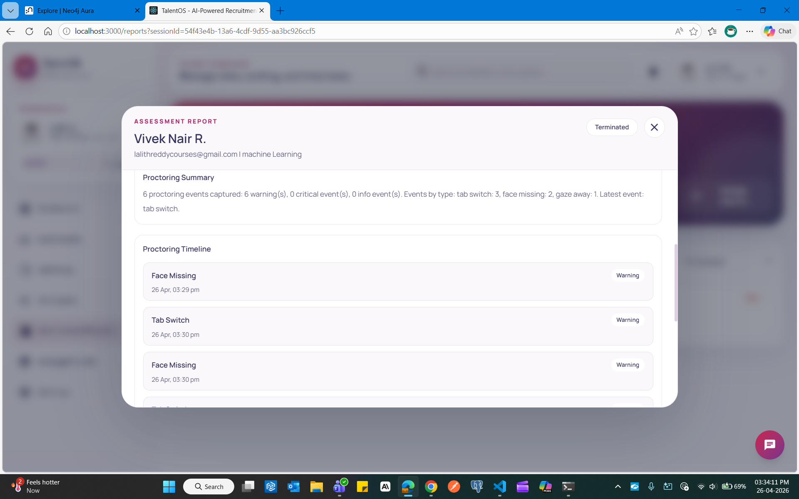
  </div>
</div>

## Requirements

- Python `3.10` only
- Node.js `20+`
- PostgreSQL
- FFmpeg on your system `PATH`
- Microsoft C++ Build Tools on Windows

Optional integrations used by some flows:

- Pinecone
- Neo4j
- Gemini API
- Redis

## Quick start

1. Read [SETUP.md](SETUP.md).
2. Create `backend/.venv` with Python 3.10.
3. Install backend dependencies from `backend/requirements.txt`.
4. Install frontend dependencies in `frontend/`.
5. Copy and update:
   - `backend/.env.example` -> `backend/.env`
   - `frontend/.env.example` -> `frontend/.env`
6. Create these PostgreSQL databases:
   - `authentication`
   - `orchestration`
   - `ats_parser_checker`
7. Download the required local models into `backend/models/` using `backend/models/README.md`.
8. Start the stack:
   - Windows: `./run-all.ps1`
   - macOS/Linux: `./run-all.sh`

## Default local ports

- Frontend: `http://localhost:3000`
- Authentication API: `http://127.0.0.1:8000`
- Orchestration API: `http://127.0.0.1:8001`
- Anti-Spoofing API: `http://127.0.0.1:8080`
- ATS Parser API: `http://127.0.0.1:8090`

## Repository map

```text
TalentOS/
  backend/
    .env.example
    requirements.txt
    anti_spoofing/
    ats_parser_checker/
    authentication/
    models/
    orchestration/
  frontend/
    .env.example
    src/
  run-all.ps1
  run-all.sh
  README.md
  SETUP.md
```

## Notes

- Use Python `3.10` only. Other versions are not supported for this repo's ML and media stack.
- `backend/models/` is required locally, but the model files are not checked in. Use `backend/models/README.md` to download the required assets.
- The frontend talks to authentication on `8000` and orchestration on `8001`.
- Service-level READMEs and SETUP guides still exist inside `backend/*`, but the root docs should be your main starting point.
